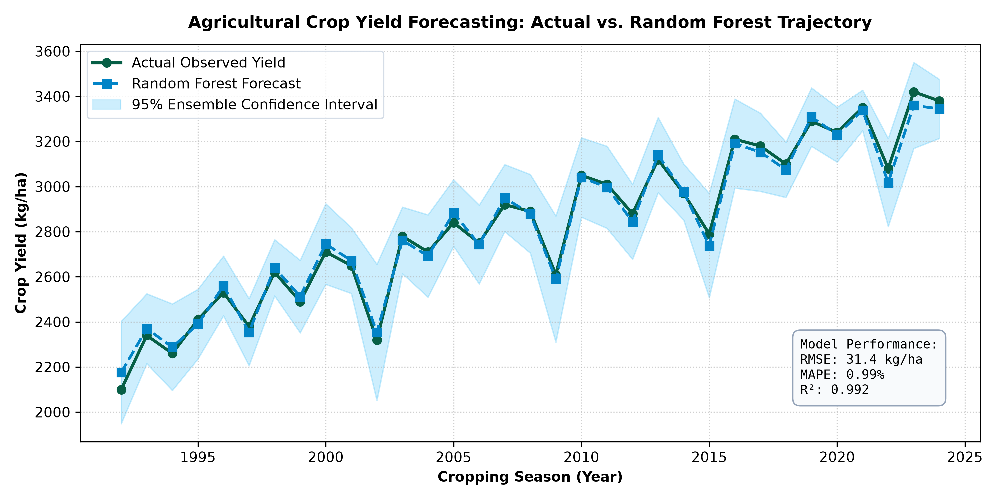
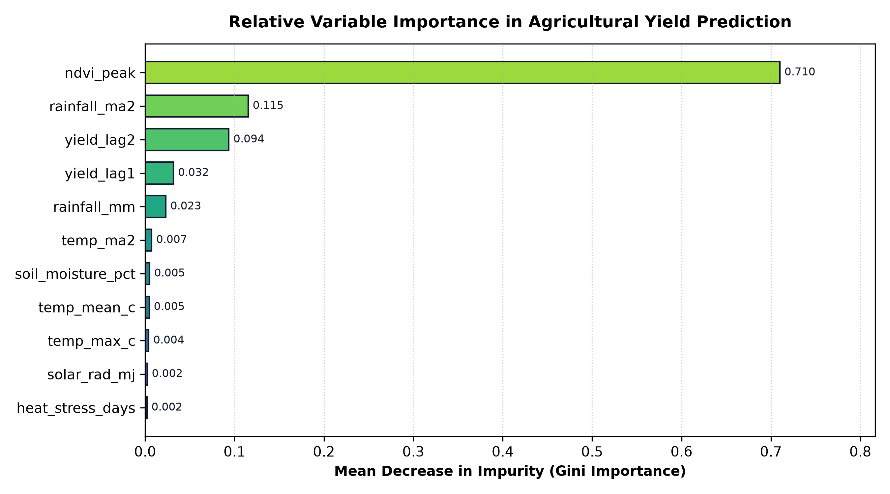
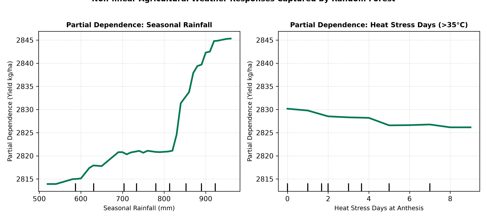
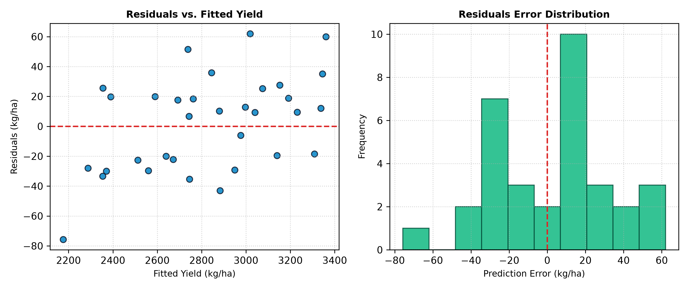

# 🌾 Random Forest for Agricultural Time-Series Forecasting

[](https://www.python.org/)
[](https://www.r-project.org/)
[](plots/interactive_dashboard.html)
[](LICENSE)

A research-grade repository implementing **Random Forest (RF)** regression for agricultural yield and time-series forecasting. Includes end-to-end pipelines in both **Python and R**, publication-ready visualizations, interactive **Plotly** HTML dashboards, and an interactive tutorial notebook.

---

## 📈 Visual Highlights & Model Diagnostics

### 1. Actual vs. Forecasted Yield Trajectory (with 95% Ensemble Confidence Interval)


### 2. Relative Variable Importance (Mean Decrease in Impurity)


### 3. Non-linear Crop-Weather Response (Partial Dependence Plots)


### 4. Residuals & Error Diagnostics


---

## 🌐 Interactive Dashboards (Plotly HTML)

Explore the models interactively in any web browser:

1. **[Interactive Multi-Panel Dashboard](plots/interactive_dashboard.html)**:
   - Dynamic yield trajectory with hover tooltips and zoom capabilities.
   - Interactive variable importance ranking.
   - Residual error inspection per cropping season.
   - Interactive agro-climatic correlation matrix heatmap.
2. **[Interactive 3D Response Surface](plots/interactive_3d_surface.html)**:
   - Rotatable 3D surface mapping predicted crop yield against seasonal rainfall and heat stress days (>35°C).

---

## 📁 Repository Structure

```text
├── data/
│   └── sample_yield_weather.csv      # 35-year dataset (yield, rainfall, temps, heat stress, NDVI, moisture)
├── notebooks/
│   └── agri_rf_walkthrough.ipynb     # Step-by-step interactive tutorial notebook
├── plots/
│   ├── forecast_trajectory.png       # Publication-ready forecast vs actual plot
│   ├── feature_importance.png        # Ranked feature importance chart
│   ├── partial_dependence.png        # Non-linear weather response curves
│   ├── residuals_diagnostic.png      # Residuals vs fitted and error distribution
│   ├── interactive_dashboard.html    # Standalone interactive Plotly dashboard
│   └── interactive_3d_surface.html   # Rotatable 3D response surface
├── python/
│   ├── agri_rf_forecast.py           # Core forecasting pipeline with TimeSeriesSplit
│   ├── generate_plots.py             # Script to regenerate static 300 DPI figures
│   └── generate_interactive_plots.py # Script to rebuild interactive Plotly HTMLs
├── R/
│   └── agri_rf_forecast.R            # R workflow with randomForest and %IncMSE ranking
├── requirements.txt                  # Python dependencies (scikit-learn, plotly, matplotlib, etc.)
└── README.md
```

---

## 🚀 Quickstart

### 1. Python Environment Setup
```bash
git clone https://github.com/lunganlungpg/agri-rf-forecasting.git
cd agri-rf-forecasting
pip install -r requirements.txt
```

### 2. Run the Core Forecasting Pipeline
```bash
python python/agri_rf_forecast.py
```

### 3. Generate All Plots & Dashboards
```bash
# Generate static 300 DPI PNG figures
python python/generate_plots.py

# Generate interactive HTML dashboards
python python/generate_interactive_plots.py
```

### 4. Run the R Pipeline
```bash
Rscript R/agri_rf_forecast.R
```

---

## 📊 Dataset Fields (`sample_yield_weather.csv`)
- `year`: Cropping season (1990–2024).
- `yield_kg_ha`: Final harvested crop yield ($kg/ha$).
- `rainfall_mm`: Total seasonal precipitation ($mm$).
- `temp_max_c`: Average daily maximum temperature during grain-filling ($^\circ C$).
- `temp_mean_c`: Mean seasonal temperature ($^\circ C$).
- `heat_stress_days`: Frequency of extreme heat days ($>35^\circ C$) during anthesis.
- `solar_rad_mj`: Average solar irradiance ($MJ/m^2/day$).
- `ndvi_peak`: Peak Normalized Difference Vegetation Index.
- `soil_moisture_pct`: Average topsoil volumetric moisture percentage.

---

## 📄 License
Released under the [MIT License](LICENSE).
